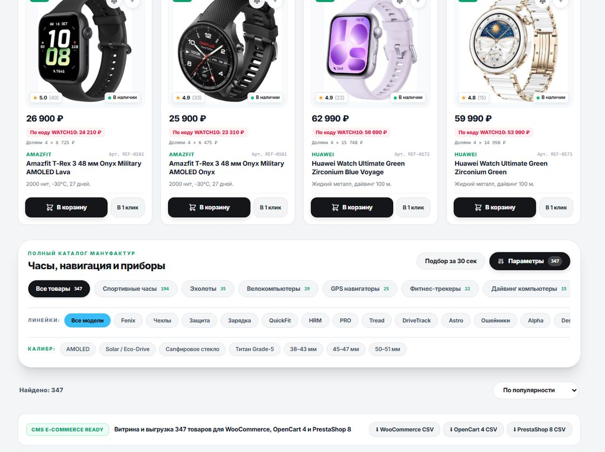
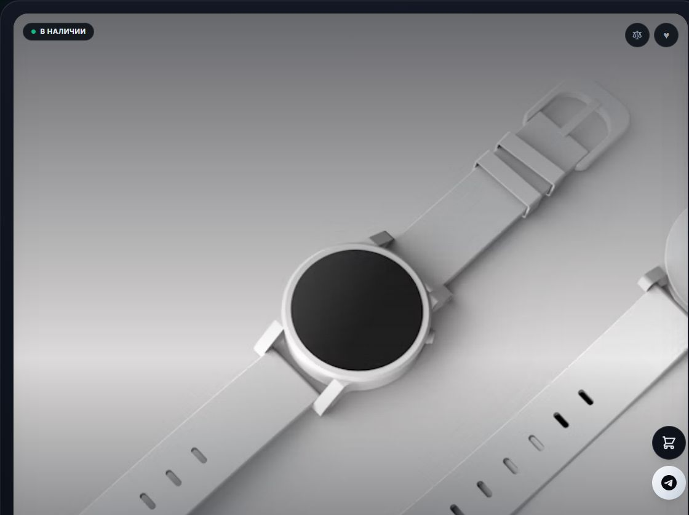

# Watchop — магазин смарт-часов + боты TG / MAX

[Витрина](https://ssrjkk.github.io/shopwatch/) · [Бот](https://t.me/wwwatchshop_bot) · [Хаб проектов](https://ssrjkk.github.io/) · [SSRJKK](https://github.com/ssrjkk) · [English version](README.md)





Витрина: каталог из `products-data.js` (347 позиции, выгружены из рабочей базы вместе с id), который сервер использует для засева и апгрейда БД; хиты продаж; бургер-меню со счётчиками; фильтры в шторке (категории, серии, сортировка — кнопка «Фильтры · N» рядом с заголовком «Все товары»); корзина с оформлением (ФИО/телефон/email/адрес/доставка); кликабельные карточки с характеристиками; заказ двумя путями — «Быстрый заказ» сразу уводит в бота с составом, «Перейти к оформлению» — форма с проверкой состава. Справа внизу — значок поддержки, разворачивающийся в Telegram/MAX, и стрелка «наверх», которая появляется после прокрутки. Навигация — настоящие ссылки с hash-маршрутами (`#/catalog`, `#/c/Эхолоты`, `#/s/fēnix`, `#/p/123`, поиск — `#/catalog?q=fenix`, выбранный подбор и вилка цены — `#/catalog?preset=hits&min=20000&max=60000`): открываются в новой вкладке, ими можно делиться. Deep Link `?start=TG-XXXX_IDxQTYxPRICE...` в `@wwwatchshop_bot` (бот создаёт заявку даже с GitHub Pages). Реквизиты — только в боте, на сайте их нет. Доставка по всей России (СДЭК, Почта России, Boxberry).

## Поиск на витрине

`parseSearch` / `getFiltered` в `index.html` — по названию, бренду, серии, категории и тексту характеристик, с нормализацией (регистр, `ё→е`, лишние пробелы), словами-паразитами («для», «купить», «цена»), совпадением падежей («бега» находит «бег»), транслитом брендов и моделей («гармин», «самсунг», «феникс», «эпл вотч», «суунто рейс») и ценовыми фильтрами: «до 60000», «от 200000», «40000-50000», «60 000» (голое число от 1000 — это ±5% от цены). Пустой результат честно показывает «Найдено: 0» и кнопку сброса; ввод с любой страницы переключает в каталог и пишет запрос в hash.

Выдача при активном поиске упорядочена по релевантности (`relScore`): совпадение в начале слова в названии — 3, внутри названия — 2, бренд/серия или категория — 2 (категория даёт ещё +2), упоминание в характеристиках — 1. Поэтому «корос пейс» показывает Pace 3 раньше VERTIX Space, «эхолот» — эхолоты, а не аккумулятор «для эхолотов», «пульсометр» — нагрудные датчики, а не часы с пульсометром в описании. Любой выбранный в шторке сортировщик («сначала дешёвые», «дороже») перекрывает релевантность.

Под полем — дропдаун подсказок (`searchSuggestions`): строится из реального каталога (префиксы названий до 4 слов, серии, бренд+серия, категории), у каждой подсказки число позиций, в конце — «Показать все N». На пустом поле показываются категории, отсортированные по числу товаров. Навигация стрелками, выбор по тапу/Enter, первый Escape закрывает подсказки, второй чистит запрос.

## Быстрый подбор, вилка цены и дополнения на странице товара

Вверху шторки фильтров — пилюли подбора: `Хиты`, `Премиум от 60 000`, `До 35 000`, и поля `От`/`До`
для цены. Счётчик на каждой пилюле считается по тому же каталогу, из которого строится выдача, поэтому
пилюля не может обещать 28 позиций и показывать 347 — `tests/presets.test.js` сравнивает именно эти
два числа. Границы из трёх источников — набранного запроса («до 65000»), пресета и полей —
пересекаются, а не перекрывают друг друга, так что запрос и пресет вместе дают вилку, а не отменяют
друг друга. Перепутанный порядок (`70000` в `От`, `20000` в `До`) читается как вилка, а не как пустая
выдача.

Выбор живёт в адресе: `#/catalog?preset=hits&min=20000&max=60000` воспроизводит его в новой вкладке,
после перезагрузки и у того, кому ты прислал ссылку; `Сбросить` чистит и пресет, и оба поля. Счётчик
`Фильтры · N` считает пресет и заполненную вилку активными фильтрами, а сводка в шторке их называет.

- **Бренды и метки характеристик.** В шторке перечислены бренды, которые реально есть в каталоге (девять, по числу позиций), и чипы по текстам характеристик: `AMOLED` 67, `Солнечная зарядка` 41, `Титан` 39, `Сапфир` 28, `GPS` 27, `ЭКГ` 7, `LTE / eSIM` 5. Чип с нулём позиций не рисуется — пустой фильтр это ловушка «нажал — ничего нет». Несколько меток пересекаются, и с брендом, пресетом, вилкой цены и набранным запросом тоже.
- **Сравнение.** Кнопка ⚖ на карточке кладёт модель в нижнюю панель — максимум четыре; панель показывает счётчик и даёт `Сравнить` и `Очистить`. Таблица сравнивает цену, бренд, серию, полку и характеристики, заголовок колонки ведёт на страницу товара. Список хранится по id, переживает перезагрузку и сбрасывается вместе с корзиной, избранным и просмотренным при пересборке каталога.
- **Лайтбокс фотографии.** Картинка на странице товара открывается крупно — запрос `w=1200` вместо `w=700` из карточки, с названием товара в доступной подписи; Escape и тап по фону закрывают. Адрес картинки, начинающийся с `javascript:`, `data:` или `vbscript:`, в источник не попадает.
- **Недавно вы смотрели.** Последние 12 позиций (на витрине 6), без дублей, по id. Пересборка каталога сбрасывает список вместе с корзиной и избранным: id из старой нумерации — уже другие часы.
- **`Product` schema для поисковиков.** Страница товара пишет JSON-LD из настоящих полей каталога — название, бренд, категория, описание, абсолютная ссылка на фото, цена в рублях и абсолютная ссылка на товар. `availability` не указываем намеренно: складских остатков в базе нет, а выдуманное — это способ получить ручную проверку. Текст товара при записи экранируется, поэтому название с `</script>` не закроет скрипт.

## Промокоды

Правила живут в настройке базы `promo_codes` одной строкой — `WATCH10=10,GARMIN5=5:GARMIN,VIP15=15:min50000`,
где после кода идёт процент, опционально бренд и опциональная минимальная сумма. Из коробки работают три
кода: 10% на всю корзину, 5% только на позиции Garmin и 15% при заказе от 50 000 ₽. Порог включительный,
скидка округляется до 10 ₽ и не может превысить сумму корзины.

Поле промокода — в корзине. `Применить` зовёт `POST /api/promo-check`, и скидку считает сервер по ценам своей
базы, а не страница: ответ содержит скидку и новую сумму. `POST /api/order` пересчитывает тот же код заново,
кладёт `promo_code` и `discount` в заявку и отвечает суммой после скидки, поэтому правка суммы в devtools
ничего не меняет. Незнакомый или истёкший код отбивается с причиной, а не молча оформляет заказ по полной
цене.

На GitHub Pages бэкенда нет, поэтому витрина не выдумывает скидку: код передаётся боту в deep link
(`?start=TG-1234_5x1x1000_PROMOWATCH10`), и бот применяет то же серверское правило при создании заявки.
Неприменившийся код всё равно сохраняется в заявке, и в уведомлении админ видит, почему вышло 0 ₽. Символы
кода — латиница, цифры, `_` и `-`: deep link остаётся ASCII и ничего не нужно кодировать в процент-экспонаты.

Управляют кодами оба бота: экран `Промокоды` в меню и `/promo` в Telegram. Список показывает коды с
условиями, `Добавить промокод` ждёт строку вида `VIP20 20 GARMIN min100000`, `Убрать промокод` забирает код.
Процент вне 1–90, код короче двух символов и неразобранное правило отвергаются с текстом.

## Демо на GitHub Pages (без сервера)

Один сайт — две точки входа с одинаковыми байтами. Канон — `public/`: сервер (`node server.js`,
Docker) раздаёт `public/index.html` + `public/products-data.js`. Корневые `index.html` и
`products-data.js` — зеркало для Pages (Settings → Pages → Deploy from a branch → `main` / `/ (root)`),
сайт: `https://ssrjkk.github.io/shopwatch/`. Правило: правишь только `public/`, потом
`npm run sync:pages` — он докопирует изменившееся в корень. Тест `tests/search.test.js`
(«не расходятся») не даёт закоммитить разъехавшиеся копии, экспорт каталога из бота пишет
сразу в обе (`products-data.js` + `public/products-data.js`).

Фото, загруженные через админку, лежат в `public/uploads/` и отдаются по `/uploads/...`;
`npm run sync:pages` зеркалит их в корневой `uploads/`, иначе на Pages этот путь 404-ит и
карточка выходит без картинки. Файлы из админки — такие же данные витрины, их коммитят в
репозиторий.

Корневая витрина работает автономно: на `*.github.io` она не зовёт `/api/*` (нет лишних 404 в консоли), каталог берёт из `products-data.js`, а заказ оформляет локально — номер `TG-2xxxx` и deep link с составом, по которому бот создаёт заявку на своей стороне.

## Запуск с сервером и ботами

1. `npm install`
2. Скопируй `.env.example` в `.env`, вставь токены:
   - `TG_BOT_TOKEN` — токен от @BotFather
   - `TG_ADMIN_ID` — свой ID: напиши боту `/id`, он ответит числом (несколько админов — через запятую)
   - `TG_ADMIN_USERNAMES` — юзернеймы админов через запятую, без числа: бот сам подставит их ID при первом сообщении
   - `MAX_BOT_TOKEN` — токен из @MasterBot / business.max.ru (бот «MAX для бизнеса» → Получить токен)
   - `MAX_ADMIN_ID` — напиши MAX-боту `/id`, он ответит числом (несколько — через запятую; остальных добавляет админ кнопкой `Админы` в самом боте)
3. `npm start` — сайт на http://localhost:3000

## Docker (для VPS, например rdp.sh)

```
docker build -t watchop .
docker run -d --name watchop -p 3000:3000 \
  -v watchop-data:/data \
  --env-file .env \
  watchop
```

`.env` не копируется в образ (см. `.dockerignore`) — передаётся через `--env-file`.
База и фото из админки лежат в volume (`DB_PATH=/data/watchop.db`, `UPLOADS_DIR=/data/uploads`), здоровье — `GET /healthz`.

## Переменные окружения

- `TG_BOT_TOKEN`, `TG_ADMIN_ID`, `TG_ADMIN_USERNAMES` — бот и админы: ID через `/id` у бота (список через запятую) либо юзернеймы, которые бот резолвит в ID при первом сообщении
- `MAX_BOT_TOKEN`, `MAX_ADMIN_ID` — то же для MAX: список числовых ID через запятую. Юзернеймов MAX не отдаёт, поэтому второй путь (резолв по нику) в нём недоступен; добавленные из бота ID живут в настройке `max_extra_admin_ids` и переживают перезапуск
- `WEBAPP_URL` — публичный HTTPS мини-приложения (кнопка web_app в ТГ)
- `SHOP_URL` — публичная витрина (кнопка-ссылка в ботах, если нет `WEBAPP_URL`)
- `CORS_ORIGIN` — разрешённые origins через запятую (по умолчанию same-origin)
- `ORDER_COOLDOWN_MS` — антиспам-кулдаун (по умолчанию 5000)
- `DB_PATH` — путь к SQLite (по умолчанию `watchop.db`)
- `UPLOADS_DIR` — папка фото из админки (по умолчанию `public/uploads`; в Docker — `/data/uploads`, чтобы переживать пересборку образа)
- `GITHUB_PUSH_TOKEN` — опционально: fine-grained PAT с `Contents: Write` на этот репозиторий, нужен, чтобы кнопка «Выгрузить и опубликовать» работала там, где у git нет сохранённых кредов (например, в контейнере на VPS). Не задан — пуш идёт через сохранённые креды. В коммит и в `.git/config` токен не попадает, из сообщений об ошибках вырезается
- `GITHUB_PUSH_REMOTE`, `GITHUB_PUSH_BRANCH` — куда и в какую ветку пушить (по умолчанию `https://github.com/ssrjkk/shopwatch/`, `main`)

Без токенов сервер работает в демо-режиме. `.env` не коммитится (см. `.gitignore`).

## Telegram-бот (админка)

- `Добавить часы` — мастер: бренд → серия → категория → название → цена → описание → фото с телефона или ссылка
- `Товары и цены` — браузер каталога: полки со счётчиками → страница по 8 позиций (листается) → карточка товара. В карточке правится любое поле: `Название`, `Бренд`, `Серия`, `Полка`, `Цена`, `Наличие`, `Описание`, `Фото` (ссылка или файлом), `В хиты` / `Убрать из хитов`, `Скидка`, `Удалить` (с подтверждением). `Скидка` — процент 1–90, цена пересчитывается с округлением до 10 ₽, прежняя уходит в `old_price` и на витрине показывается серой зачёркнутой; повторная скидка считается от `old_price`, «Снять скидку» возвращает цену. `Найти` ищет по названию, бренду, серии и описанию без учёта регистра (и по-русски тоже). Чтобы GitHub Pages увидел изменения — `Экспорт каталога` + коммит `products-data.js`
- `Реквизиты оплаты` — изменить текст / скрыть-показать на сайте
- `Тексты и контакты` — баннер, телефон, email, адрес, способы доставки (`delivery_methods`), свои полки каталога (`extra_categories`), ссылки ТГ/MAX, ИП/ИНН/ОГРНИП. Меняются только публичные настройки из списка `EDITABLE_SETTINGS`; служебный счётчик номеров заявок `last_order_num` из бота не перезаписывается — его порча ломает выдачу кодов, и в обоих ботах на это есть отказ с прямым текстом
- `Фото на стоках` — отчёт по картинкам: сколько позиций со своим фото из админки, по каким хостам разложены остальные и какие фотографии повторяются на нескольких товарах. Нужен, потому что каталог собран на стоках Unsplash, и витрина выглядит макетом, а не магазином
- `Последние заказы` — браузер заявок: фильтр по статусу со счётчиками, поиск по номеру/фамилии/телефону/товару, карточка (состав, суммы, клиент, доставка, TG покупателя), смена статуса (`Новый`, `Trade-In`, `В сборке`, `Оплачен`, `Отменен`), удаление с подтверждением и переход к списку, плюс `Новая заявка` — ручной заказ в три шага (состав вида `12x2, 45`, ФИО, телефон), сумма считается по ценам базы. Те же статусы работают кнопками в уведомлении о новой заявке
- `Сводка сайта` — товары по полкам, число хитов и позиций со скидкой, заявки по статусам, за 7 дней, сколько ждут действия, оплачено на сумму, показаны ли реквизиты
- `Экспорт каталога` — превью расхождения базы и файла; `Выгрузить` перезаписывает `products-data.js` и `public/products-data.js`, сохраняет старую копию в `.bak` и присылает файл документом; `Выгрузить и опубликовать` показывает, что уйдёт в репозиторий, и после `Подтвердить публикацию` делает коммит и push — витрина на GitHub Pages обновляется сама
- `Импорт товаров` — массовая выкладка: таблицу можно прислать текстом или файлом `.csv`/`.txt` (`.xlsx` попросит пересохранить в CSV). Столбцы `бренд;серия;категория;название;цена;описание;фото`, разделитель `;`, таб или запятая, строка-шапка распознаётся. Бот сначала показывает разбор: сколько новых позиций, сколько уже есть в базе (по ключу бренд+серия+категория+название — правка цены не считается новой позицией) и какие строки не прошли и почему. Запись — только после кнопки `Записать`, одной транзакцией: при сбое не записывается ни строки. Категории строго те, что на витрине, список сторожит тест. До 2000 строк за раз, файл до 2 МБ
- `Дизайн` — смена витрины: Stealth Titanium или Classic Light (пишет public/index.html и корень, дальше — «Экспорт каталога» + коммит)
- `Промокоды` (и `/promo`) — список активных кодов с условиями, `Добавить промокод` ждёт строку вида `VIP20 20 GARMIN min100000`, `Убрать промокод` забирает код. Правила лежат в настройке `promo_codes` и переживают перезапуск; неверный процент и короткий код отвергаются с текстом
- `Админы` — список админов с источником (`.env` или бот); добавить по ID или юзернейму, убрать добавленных через бота. Админы из `.env` из бота не убираются. Добавленные хранятся в настройках БД (`tg_extra_admin_ids`, `tg_extra_admin_usernames`) и переживают перезапуск; юзернейм резолвится в ID при первом сообщении человека боту и тоже запоминается
- Клиентам: отправь номер `TG-XXXX` — бот пришлет состав, сумму и реквизиты
- `/id` — узнать свой Telegram ID

## Безопасность и бекапы

- Номера заявок идут по порядку, поэтому чужая непривязанная заявка в ботах показывается только за последние 4 цифры телефона из заказа (3 попытки). Владелец и админ смотрят без проверки.
- Бекап БД: ночной VACUUM INTO в BACKUP_DIR (по умолчанию рядом с базой), ротация BACKUP_KEEP файлов, проверка integrity_check при старте, кнопка «Бекап БД» в обоих ботах (в Telegram присылает файл).
- Публикация на GitHub Pages: 3 попытки push с бэкоффом и rebase при non-fast-forward.
- Цены и промокод всегда считает сервер по своей БД: подмена цены или кода в deep link не даёт скидку; расхождение каталога на витрине и в БД — отказ в заявке, а не оформление «не того».
- Повторная отправка формы не плодит дубли (ключ `X-Idempotency-Key`), остатки списываются атомарно в одной транзакции с заявкой; ручка `/health` проверяет БД, целостность, диск, свежесть бекапа, последнюю публикацию и дрейф каталога.

### Восстановление из бекапа (runbook)

1. Останови сервис (`systemctl stop watchop` или `docker stop ...`).
2. Отложи битый файл, не удаляй: `cp watchop.db watchop.db.broken.$(date +%F)`.
3. Выбери свежий `backups/watchop-*.db`: `sqlite3 <файл> "PRAGMA integrity_check;"` → ждём `ok`.
4. Положи его как `watchop.db` (тот же `DB_PATH`, что в `.env`), права `640`, владелец — пользователь сервиса.
5. Сверь порядки: `SELECT COUNT(*) FROM orders/products/settings`, `SELECT value FROM settings WHERE key='last_order_num'`; сделай тестовый заказ и отмени.
6. Дубли номеров исключены конструктивно: счётчик `last_order_num` + пропуск занятых + `UNIQUE(order_code)`.
7. Стартуй сервис, проверь `curl /health` (все `ok`), витрину и `/id` в ботах. Если витрина отстала — «Экспорт каталога» из бота и push.

## MAX-бот (те же экраны админки, что в Telegram)

Управление сайтом построено на общих функциях работы с базой, поэтому MAX-бот повторяет
витрину админки один в один (домен `platform-api2.max.ru`, авторизация заголовком `Authorization`):

- Меню: `Добавить часы` (мастер 6 шагов + фото/ссылка), `Товары и цены` (полки → страница → карточка: `Название #ID`, `Бренд #ID`, `Серия #ID`, `Полка #ID`, `Цена #ID`, `Наличие #ID`, `Описание #ID`, `Фото #ID`, `В хиты #ID`, `Скидка #ID`, `Удалить #ID` с подтверждением, `Найти товар`, листание `Каталог ←/→`), `Реквизиты оплаты` (изменить/скрыть-показать), `Тексты и контакты` (Баннер/Телефон/Email/Адрес/Доставка/Категории/Ссылка ТГ/Ссылка MAX/ИП/ИНН/ОГРНИП), `Последние заказы` (фильтр `Заказы: СТАТУС`, `Заявка TG-XXXX`, `Найти заявку`, `Новая заявка`, смена статуса, удаление), `Экспорт каталога` → `Подтвердить экспорт`, `Выгрузить и опубликовать` → `Подтвердить публикация`, `Импорт товаров` → `Записать N`, `Админы` (`Добавить по ID`, `Добавить по имени`, `Убрать ID N`, `Убрать имя ...`), `Промокоды` (`Добавить промокод`, `Убрать промокод`), `Сводка сайта`, `Фото на стоках`, `Дизайн` (`Дизайн: Stealth` / `Дизайн: Classic`), `Отмена` — сброс шага
- Кнопка меню всегда важнее ввода: пока бот ждёт значение поля или шаг мастера, нажатие кнопки админки прерывает ввод, а не уезжает в него текстом. Поиск заявки по номеру в админке не перехватывается клиентским экраном заказа
- Старые команды тоже работают: `/orders`, `/pay ТЕКСТ`, `/add БРЕНД | СЕРИЯ | НАЗВАНИЕ | ЦЕНА`, `/del ID`, `/products`, `/export`, `/id`
- Клиентам: номер `TG-XXXX` — состав + сумма + реквизиты; остальное пересылается админу
- Примечание: long polling подходит для теста; для продакшена MAX рекомендует Webhook (`POST /subscriptions`)
- Мульти-админ теперь в обоих ботах. В Telegram — по ID (`TG_ADMIN_ID` списком) и по юзернейму (`TG_ADMIN_USERNAMES`, который резолвится в ID при первом сообщении человека). В MAX — по числовым ID (`MAX_ADMIN_ID` списком плюс добавленные кнопкой `Админы` → `Добавить по ID`) и по ожидаемым именам (`Добавить по имени`): MAX не отдаёт юзернейм в обновлениях, только отображаемое имя, поэтому бот привязывает первого написавшего с совпавшим именем. Экран `Админы` в обоих ботах помечает источник: из `.env` или из бота, и убирает только добавленных ботом
- Остальные экраны админки (каталог с правкой полей, скидки, заявки со статусами и удалением, импорт, сводка, отчёт по картинкам, публикация) — общие с Telegram и покрыты тестами на реальном MAX-диспетчере (`tests/max.test.js`). Живьём MAX не проверялся нигде: `MAX_BOT_TOKEN` пуст, так что тесты подтверждают логику вызова, а не ответ платформы

## Каталог: база и файл

`products-data.js` (он же `public/products-data.js`, тест следит, чтобы копии не расходились) — источник для витрины без бэкенда и для засева пустой базы. Позиции в файле содержат `id`, поэтому пустая база воспроизводит файл один в один, и `#/p/<id>` и payload заказа значат один и тот же товар и на сервере, и на GitHub Pages.

Сервер при старте добавляет в базу то, чего в ней нет, но не воскрешает удалённое: таблица `seed_marks` хранит ключи позиций, которые в базе уже были, а картинки админки больше не перезаписываются файлом. Отсюда расхождение: в рабочей базе может быть больше позиций, чем в файле — например, товары, добавленные через админку. Лечится кнопкой `Экспорт каталога` в боте: она пишет актуальную базу в обе копии файла (предыдущая версия остаётся в `products-data.js.bak`), присылает файл документом и напоминает, что его надо закоммитить — Pages берёт каталог из репозитория. Экспорт блокируется, если позиций в базе меньше, чем в файле; запись идёт через временный файл с проверкой, что он читается, и откатом из `.bak`, поэтому битый результат не может ни испортить рабочий файл, ни перезаписать резервную копию.

## Витрина: скорость

Замерено на рабочем каталоге (347 позиции), а не на глаз:

- **Сжатие.** Сервер отдаёт HTML/JS/JSON через brotli, если клиент его принимает, иначе gzip (`zlib`, без новых зависимостей); замер живым GET'ом: `index.html` — 263 958 Б → 52 419 Б, `/api/state` — 135 347 Б → 17 906 Б, `products-data.js` — 106 037 Б → 10 476 Б. Картинки и ответы меньше 1 КБ не оборачиваем, `Vary: Accept-Encoding` ставится, ETag и 304 продолжают работать. GitHub Pages жмёт сам, отсюда выигрыш на локальном запуске и на VPS.
- **Оконная сетка каталога.** В DOM живёт не больше 60 карточек, сколько ни листай: сверху и снизу — заглушки высотой с убранное, так что полоса прокрутки не прыгает. До этого сетка только дописывалась: после полного пролистывания 347 карточек и 3470 узлов вместо 60 и 600. Проверка числом — в `tests/virtual.test.js`.
- **Размер картинок по слоту.** В базе запечён `w=600`, хотя карточка в макете `max-w-md` — 181px, а превью в корзине — 64px. Витрина просит `w=400` для карточки, `w=700` для страницы товара и `w=160`/`w=140` для миниатюр. Для Unsplash добавляется `fm=webp`: проверено по факту — `Content-Type: image/webp`, сигнатура `RIFF…WEBP`, 7 786 Б вместо 10 882 Б на карточку (−28%). Чужие хосты (Wikimedia) не переписываем — они параметр ширины не понимают.
- **Кэш фото.** `/uploads/...` отдаётся с `Cache-Control: public, max-age=31536000, immutable` — имя файла уникально на каждую загрузку, поэтому устареть он не может. Сама витрина кэшироваться навсегда не может (`max-age=0`), иначе правка цены не отобразилась бы до сброса кэша.
- **Окно и в избранном.** Тот же ограничитель, что и в каталоге: больше 60 карточек в DOM не попадает на любой глубине прокрутки.
- **Индексы БД.** `products(category)`, `products(is_hit)`, `orders(status)`, `orders(created_at)`: полки, хиты, фильтры сводки и заявки за 7 дней читаются индексами, планы показывает `EXPLAIN QUERY PLAN`.
- **Что НЕ оптимизировали и почему.** Поиск по каталогу: `getFiltered()` на 347 позициях стоит 0.02–0.31 мс, предвычисление снипов только добавило бы кода. Чтение базы из-под сервера: `/api/state` отвечает за 5–11 мс целиком.

## Мини-приложение Telegram (Mini App)

Та же витрина открывается внутри Telegram:

1. Задеплой бота на публичный HTTPS (VPS/rdp.sh) и задай в `.env`: `WEBAPP_URL=https://<твой-домен>`
2. В @BotFather: `/setmenubutton` → выбери `@wwwatchshop_bot` → пришли `WEBAPP_URL` + текст «Магазин»
   (или `/newapp` для отдельной иконки приложения)
3. Бот сам покажет кнопку «Открыть магазин» (web_app) в `/start` — и клиентам, и админу

Что умеет мини-апп: `telegram-web-app.js`, `ready/expand`, тема из `themeParams`,
`BackButton` (назад в каталог), `MainButton` («Заказать • цена» на карточке товара),
`disableVerticalSwipes`, `HapticFeedback` при заказе, подпись `initData`
уходит в `POST /api/order` и проверяется сервером (`verifyTelegramInitData`: подпись + свежесть < 24ч, иначе `403`).

## API сайта

- `GET /api/state` → `{ settings, products }` (реквизитов `payment_details` в ответе нет — они только в боте)
- `POST /api/promo-check {code, items}` → `{ code, percent, subtotal, discount, total }` или `400` с причиной; цены берутся из базы, неизвестный код отбивается
- `POST /api/order {items, total, customer}` → `{ orderCode: TG-XXXX, total }`, цены и названия сервер пересчитывает по своей БД, телефон — минимум 10 цифр, антиспам 5 сек (`429`)
- `GET /healthz` → `{ ok, products, orders, uptime }` (для Docker HEALTHCHECK и мониторинга)

## Защита

- Цены и названия в заказе берутся только из серверной БД (подмена цены/суммы клиентом игнорируется, `total` считает сервер). В deep link бота цена из `?start=` сверяется с базой: если расходится — заявка не создаётся (это либо правка ссылки, либо устаревший каталог на витрине, где под тем же id другой товар), клиент получает внятный ответ, а админ — сообщение `⚠️ ЗАКАЗ TG-XXXX НЕ СОЗДАН` с обеими ценами; несуществующая позиция не превращается в «Товар #123»
- Промокод никогда не несёт сумму: из запроса берётся только код, а скидку `evaluatePromo` пересчитывает по ценам базы — подделанные `total` или `discount` в теле запроса ни на что не влияют
- Номер заказа выдаёт сервер и обходит занятые значения: два покупателя статической витрины не получают один номер на двоих, а при совпадении бот берёт свободный и сообщает об этом админу
- Состав и реквизиты заказа показывает только его владелец (первый, кто открыл ссылку) или админ; номер заказа сам по себе доступом не считается
- Статусы заказа (`В сборку` / `Оплачен` / `Отменить`) меняет только админ — и в Telegram, и в MAX
- Экран «Заказ принят» без заказа в этой сессии возвращает в каталог; заказ этой сессии переживает перезагрузку (sessionStorage)
- Ссылки на MAX скрыты, пока MAX-бот не настроен (`MAX_BOT_TOKEN`), — покупатель не уходит в 404
- Подпись Mini App: HMAC + свежесть `auth_date` < 24ч, иначе `403`
- Валидация: до 50 позиций, количество 1–99, телефон от 10 цифр, несуществующий товар — `400`; лимит тела `100kb` (`413`); ошибки асинхронного обработчика не роняют запрос
- Экранирование всех текстов товаров при рендере (защита от stored XSS через бота); испорченный `localStorage` не убивает витрину, а сбрасывается
- Кодировка на приёме: тело заказа читается строгим UTF-8, а если байты ему не подошли — перекодируются из `windows-1251` (так Excel и старые клиенты несут русские имена). Без этого `body-parser` молча ставит `U+FFFD`, и в заявке лежит «?????» вместо имени покупателя. Все строки проходят через `cleanText`: NFC-склейка (`е` + диакритика → `ё`), управляющие символы долой, `\r\n` к `\n`. Если `U+FFFD` остался после перекодировки — поле отбивается с `400`, а не сохраняется мусором. Тот же декодер стоит на загрузке CSV-файла в импорт
- Корзина и избранное хранят id позиций. Витрина сверяет отпечаток каталога (`watchop_catfp`) и при его расхождении сбрасывает оба списка с понятным тостом: пересобранный файл означает другую нумерацию, а старый id — уже другой товар
- Security-заголовки (`nosniff`, `SAMEORIGIN`, `Referrer-Policy`, `Permissions-Policy`)
- CORS закрыт по умолчанию (same-origin); для кросс-домена задай `CORS_ORIGIN=https://a,https://b` в `.env`
- Антиспам заказов: кулдаун на IP (`ORDER_COOLDOWN_MS`, по умолчанию 5000)
- Параметризованные запросы SQLite; токены только в `.env` (не коммитится)

## Тесты

`npm test` — 208 тестов в 23 сюитах, встроенный раннер Node (без установки):

- `tests/api.test.js` — живой сервер на временном порту и пустой БД: state (300+ товаров), заказ `TG-XXXX`, антиспам `429`, `400`/`403`, перерасчёт цен, данные покупателя, `healthz`, статика, сжатие ответов и `immutable`-кэш загрузок, промокоды: `/api/promo-check` считает сервер, заказ уходит с суммой после скидки, неизвестный код отбит
- `tests/promo.test.js` — движок промокодов как чистые функции: правила разбираются и собираются обратно без потерь, мусор и процент вне диапазона не становятся скидкой, брендовый код считает только свои позиции в смешанной корзине, минимальная сумма включительная, неприменившийся код оставляет полную сумму и внятную причину, цены берутся из lookup, а не из запроса, скидка не превышает сумму корзины, а список для админа печатает код, процент и условия
- `tests/initdata.test.js` — подпись Mini App: валидная/битая/пустая/без токена
- `tests/max.test.js` — MAX-паритет: меню, мастер добавления, цены, реквизиты, настройки (включая покрытие экраном «Тексты и контакты» всех правимых полей), статусы, клиентский поиск, отмена, кнопка магазина, импорт и экспорт каталога, админы: экран, `Добавить по ID`, `Убрать ID N`, отказ трогать админа из `.env`, уведомление уходит каждому админу, список переживает рестарт, кнопка `Админы` прерывает ввод реквизитов, промокоды: экран, добавление, отзыв, отказ на неверном проценте и на несуществующем коде, кнопка `Промокоды` прерывает незавершённый ввод
- `tests/virtual.test.js` — виртуализация: в DOM не больше `WINDOW_CARDS` карточек на любой глубине прокрутки (заглушки сверху и снизу держат высоту), избранное в том же окне, короткий список рендерится целиком, после смены фильтра окно не пустует, экранирование XSS, корзина (add/qty/remove/оформление/проверка), deep link с составом, hash-маршруты и ссылки, хиты, избранное без перерисовки
- `tests/tgadmin.test.js` — мульти-админ Telegram: ID списком, юзернеймы резолвятся в ID при первом сообщении и запоминаются, добавленные переживают перезапуск, админа из `.env` из бота не убрать, мусорный ID отклоняется
- `tests/discount.test.js` — скидки: округление до 10 ₽, повторная скидка считается от исходной цены, а не от уже уценённой, снятие скидки возвращает `old_price`, витрина показывает зачёркнутую старую цену
- `tests/import.test.js` — массовый импорт: разбор разделителей (`;`, таб, запятая), строка-шапка, категории только с витрины, цена «24 990 ₽», превью с причинами отбраковки, запись одной транзакцией (сбой — не записана ни одна строка), лимит строк
- `tests/admin.test.js` — функции админки: полки, страница каталога с регистронезависимым поиском, карточка, правка поля, хиты, удаление, разбивка заявок по статусам, смена статуса, сводка, отчёт по стоковым картинкам, удаление заявки, гейт правимых настроек, и карточка заявки с промокодом и его скидкой (или с причиной, почему вышло 0 ₽)
- `tests/publish.test.js` — публикация: план без токена (обычный `push origin`) и с токеном (явный URL, remote в конфиге не переписывается), белый список путей коммита (ни базы, ни `.env`, ни `server.js`, ни `-A`), вырезание секрета из вывода git, подсказка про доступ только когда он берётся из кредитов
- `tests/encoding.test.js` — кодировка: strict UTF-8, добор windows-1251, NFC-нормализация, отбрасывание управляющих символов, тело без валидного декода остаётся как было, а не выкидывается
- `tests/tgdeeplink.test.js` — заявка из deep link: состав и цена из базы, ссылка с чужой ценой не создаёт заказ и поднимает админу `НЕ СОЗДАН`, несуществующий id отклоняется, повтор того же состава не дублирует заказ, коллизия номера получает свободный, детали видит только владелец или админ, счётчик номеров не выдаёт занятые, промокод из deep link считает сервер, а неизвестный код оставляет полную сумму и сохраняется в заявке, чтобы админ видел причину
- `tests/search.test.js` — поиск и flow: «Найдено: 0» вместо цифр прошлого запроса и кнопка сброса, поиск по характеристикам/транслиту/падежам, релевантность выдачи («корос пейс» → Pace до VERTIX Space, «эхолот» → товары категории, а не аккумулятор для неё, «эпл вотч» и «суунто рейс» находятся) и то, что выбранный сортировщик её перекрывает, ценовые фильтры (`до`, `от`, `40000-50000`, голое число ±5%), запрос в hash и восстановление из ссылки, сброс висячего запроса при переходе по категории, «назад в каталог» туда, откуда пришёл, заказ на GitHub Pages без бэкенда (success + deep link, `/api/*` не зовём), настоящая ошибка бэкенда показывается, быстрый заказ, идентичность `index.html` и `public/index.html`
- `tests/catalog-export.test.js` — выгрузка базы в файл-источник: нормализация строки БД, генерация читается и в Node, и в браузере (кавычки/переносы в названиях), id не съезжают, боевой файл несёт уникальные положительные id и в обеих копиях одинаковые, повтор выгрузки даёт тот же файл, diff «что живёт только в базе», реальный `applySeed` (пустая база, повторный запуск, удалённый товар не воскресает, новая позиция догружается), атомарная запись с откатом и сохранением `.bak`
- `tests/ui.test.js` — подсказки (строятся из каталога, счётчики совпадают с выдачей и учитывают активный фильтр, Escape в два шага, пересборка индекса при смене каталога, цифра в запросе сужает выдачу), шторка фильтров (заголовок «Все товары»/активный фильтр, счётчик на кнопке, сброс, диалог для скринридера), стрелка наверх по прокрутке, экран «заказ принят» без заказа, телефон из букв, битый `localStorage`, сброс корзины и избранного при пересборке каталога (и сохранение при том же составе), бренд в подсказках в одной форме («Garmin», а не «GARMIN Descent» рядом), скрытая ссылка MAX и разметка: вкладки с «Корзиной» в конце, иконка корзины, логотипы Telegram/MAX в значке поддержки, счётчик моделей в `og:description` сверяется с длиной каталога, а размеры в обоих README — с фактическим числом байт и brotli у `index.html` и `products-data.js`
- `tests/presets.test.js` — быстрый подбор, фасеты, сравнение и дополнения страницы товара: счётчик на пилюле «Хиты» равен длине выдачи, границы пресета и полей цены пересекаются с набранным запросом, перепутанный порядок читается вилкой, выбор доезжает по hash-ссылке и сбрасывается кнопкой, `Фильтры · N` его видит, чипы брендов воспроизводят набор брендов каталога и их числа равны длине выдачи, чип характеристики не рисуется, если по нему нет ни одной позиции, несколько фасетов пересекаются, а не расширяют, `brand=` и `spec=` доезжают по ссылке, а неизвестный ключ в адресе игнорируется, лайтбокс просит `w=1200` и подписывает картинку, `javascript:`/`data:`/`vbscript:` не становятся источником, «недавно смотрели» без дублей и с потолком, пересборка каталога сбрасывает его как корзину и избранное, сравнение ограничено четырьмя, повторное нажатие убирает модель, его таблица несёт реальные поля и экранирует название, а список переживает перезагрузку и чистится при пересборке каталога, и JSON-LD несёт реальные поля без `availability`, и `</script>` в названии не разрывает скрипт, а поле промокода в корзине показывает только то, что посчитал сервер — на статическом хостинге код уходит в бота через deep link вместо локальной скидки
- `tests/helpers/dom.js` — общий harness: монтирует inline-скрипт витрины на фиктивных элементах

---

**SSRJKK** — [GitHub](https://github.com/ssrjkk) · [Telegram](https://t.me/ssrjkk) · [Projects hub](https://ssrjkk.github.io/) · [Bot catalogue](https://t.me/ssrjkk_bot)
