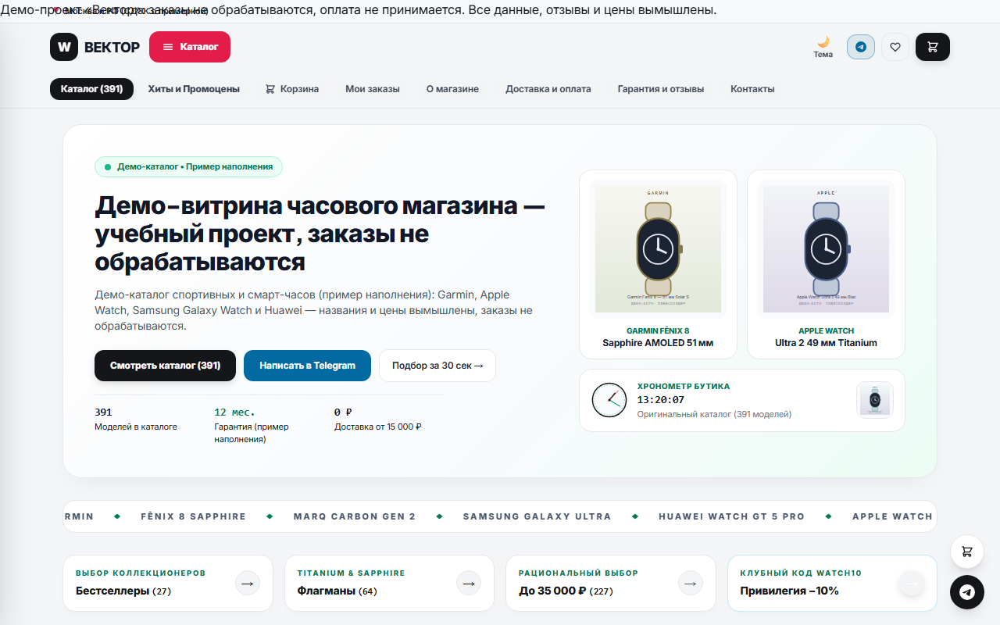
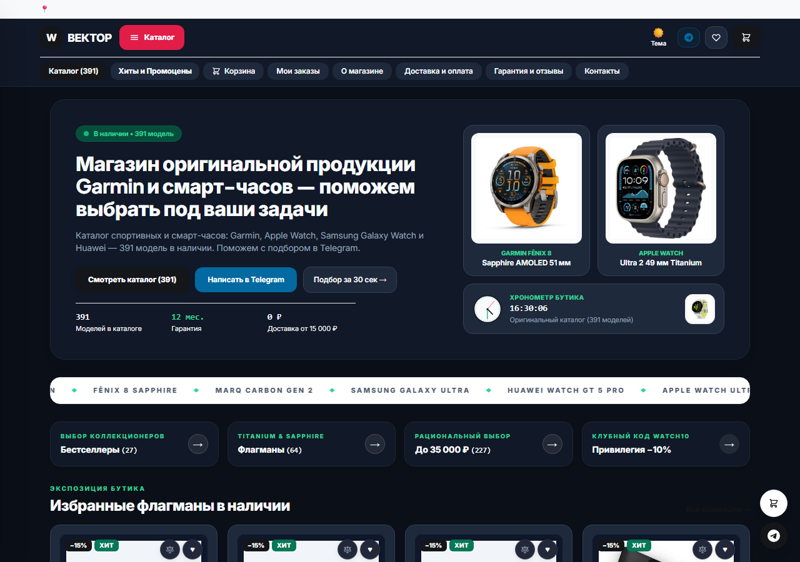
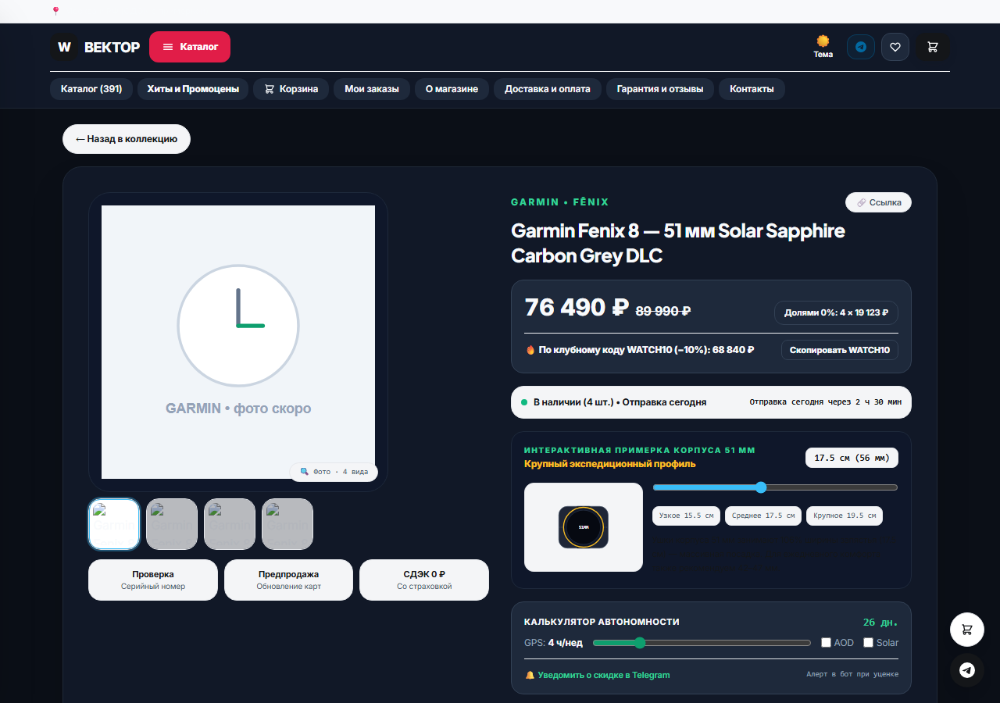

# Vektor — watch store with Telegram and MAX bots

> Working store: cart orders go to a manager in Telegram/MAX, payment follows order confirmation. Catalog photos are official manufacturer shots.

[Storefront](https://ssrjkk.github.io/shopwatch/) · [Русская версия](README.md)





Storefront: a catalog of 391 products read from `products-data.js` (exported from the live
database together with their ids), which the server also uses to seed and upgrade the database;
bestseller strip; burger menu with counters; filters in a bottom sheet (categories, model lines,
sorting — a `Фильтры · N` button next to the `Все товары` heading); cart with checkout (full
name / phone / email / address / delivery method); cards that open into full specs; two ways to
order — `Быстрый заказ` hands the cart straight to the bot, `Перейти к оформлению` opens a form
that checks the contents before submitting. Bottom right: a support badge that expands into
Telegram and MAX, and a scroll-to-top arrow that appears after scrolling. Navigation uses real
links with hash routes (`#/catalog`, `#/c/Эхолоты`, `#/s/fēnix`, `#/p/123`, search as
`#/catalog?q=fenix`, a chosen preset and price window as
`#/catalog?preset=hits&min=20000&max=60000`), so every view opens in a new tab and can be shared. The deep link
`?start=TG-XXXX_IDxQTYxPRICE...` goes to `@wwwatchshop_bot`, which creates the order even when
the page came from GitHub Pages. Payment requisites exist only in the bot, never on the site.
Delivery across Russia (CDEK, Russian Post, Boxberry).

Admin button labels are quoted in Russian throughout this file because those are the literal
strings the bots show: the shop's buyers and admins are Russian-speaking.

## Search on the storefront

`parseSearch` / `getFiltered` in `index.html` match name, brand, model line, category and the
spec text, with normalization (case, `ё→е`, collapsed whitespace), stop words stripped («для»,
«купить», «цена»), case endings matched («бега» finds «бег») and transliteration for brands and
models («гармин», «самсунг», «феникс», «эпл вотч», «суунто рейс»). Price filters: «до 60000»,
«от 200000», «40000-50000», and a bare number from 1000 («60 000») means ±5% of the price. An
empty result honestly says `Найдено: 0` and offers a reset button; typing from any page switches
to the catalog and writes the query into the hash.

While a query is active the result set is ordered by relevance (`relScore`): a match at the start
of a word in the name scores 3, anywhere in the name 2, brand/model line or category 2 (a category
match adds another 2), a mention in the specs 1. That is why «корос пейс» lists Pace 3 before
VERTIX Space, «эхолот» lists echo sounders rather than an echo-sounder battery, and «пульсометр»
lists chest straps rather than watches that mention a heart-rate sensor in their description. Any
sorter chosen in the filter sheet («сначала дешёвые», «дороже») overrides relevance.

Below the field there is a suggestions dropdown (`searchSuggestions`) built from the live catalog:
name prefixes up to four words, model lines, brand+model line, categories, each carrying its
product count, and `Показать все N` at the end. An empty field shows categories ordered by product
count. Arrow keys navigate, tap or Enter selects, the first Escape closes suggestions, the second
clears the query.

## Quick pick, price range and product-page extras

At the top of the filter sheet there are preset chips — `Хиты`, `Премиум от 60 000`, `До 35 000` —
plus `От`/`До` price fields. Every chip carries a count computed from the same catalog the result
list reads, so a chip cannot promise 28 products and then show 347; `tests/presets.test.js` compares
those two numbers. The three sources of a price bound — a typed query («до 65000»), the preset and
the fields — intersect instead of overriding each other, so a query and a preset together give a
window rather than cancelling out. A swapped range (`70000` in `От`, `20000` in `До`) is read as a
window, not as an empty result.

The selection lives in the URL: `#/catalog?preset=hits&min=20000&max=60000` reproduces it in a new
tab, after a reload or on the receiving end of a share, and `Сбросить` clears the preset and both
fields. The `Фильтры · N` counter counts a preset and a filled price window as active filters, and
the sheet summary names them.

- **Brand and spec facets.** The sheet lists the brands actually present in the catalog (nine, ordered by how many positions each holds) and spec chips read from the spec text: `AMOLED` 67, `Солнечная зарядка` 41, `Титан` 39, `Сапфир` 28, `GPS` 27, `ЭКГ` 7, `LTE / eSIM` 5. A chip with zero matches is not rendered — an empty filter is a trap. Several chips intersect, and they intersect with the brand, the preset, the price window and the typed query as well.
- **Comparison.** The ⚖ button on a card adds a model to a bottom bar, up to four; the bar shows the count and offers `Сравнить` and `Очистить`. The table compares price, brand, model line, shelf and specs, each column heading linking to that product page. The list is stored by id, survives a reload and is cleared together with cart, favorites and recently-viewed when the catalog is rebuilt.
- **Photo lightbox.** The image on the product page opens full-size — a `w=1200` request instead of the card's `w=700` — with the product name as the accessible label; Escape or a tap on the backdrop closes it. An image address starting with `javascript:`, `data:` or `vbscript:` never reaches the lightbox.
- **Recently viewed.** The last 12 products (6 shown) above the catalog, no duplicates, stored by id. A catalog rebuild drops the list together with cart and favorites: an id from the previous numbering is a different watch.
- **`Product` schema for search engines.** The product page writes a JSON-LD block built from real catalog fields — name, brand, category, description, absolute image, price in RUB and an absolute product URL. `availability` is left out on purpose: the database holds no stock quantities, and inventing one is how a shop earns a manual review. Product text is escaped as it is written, so a name containing `</script>` cannot close the script tag.

## Promo codes

Rules live in the database setting `promo_codes` as one line — `WATCH10=10,GARMIN5=5:GARMIN,VIP15=15:min50000`
— meaning code = percent, optionally restricted to a brand and to a minimum cart. The three seeded codes
are 10% off the whole cart, 5% off Garmin positions only, and 15% off orders from 50 000 ₽. Thresholds are
inclusive, the discount rounds to 10 ₽ and never exceeds the cart total.

The promo field sits in the cart. `Применить` calls `POST /api/promo-check`, and the server — not the page —
takes prices from its own database and returns the discount and the new total. `POST /api/order` re-evaluates
the same code, stores `promo_code` and `discount` on the order and answers with the discounted total, so a
price edited in devtools changes nothing. An unknown or expired code is rejected with its reason instead of
quietly creating a full-price order.

On GitHub Pages there is no backend, so the page does not invent a discount: it hands the code to the bot in
the deep link (`?start=TG-1234_5x1x1000_PROMOWATCH10`), and the bot runs the same server-side evaluation when
it creates the order. A code that did not apply is still stored, and the admin notification says why it gave
0 ₽. Codes are Latin letters, digits, `_` and `-` — the deep link stays ASCII and nothing has to be
percent-encoded on the way to the bot.

Admins manage codes from both bots: the `Промокоды` screen in the menu, `/promo` in Telegram. It lists the
codes with their conditions, adds one with a line like `VIP20 20 GARMIN min100000` and removes it; a percent
outside 1–90, a code shorter than two characters and an unparseable rule are refused.

## Running on GitHub Pages (no server)

One site, two entry points with byte-identical files. `public/` is canonical: the server
(`node server.js`, Docker) serves `public/index.html` + `public/products-data.js`. The root
`index.html` and `products-data.js` are the mirror used by Pages (Settings → Pages → Deploy from a
branch → `main` / `/ (root)`), the site lives at `https://ssrjkk.github.io/shopwatch/`. Rule: edit
only `public/`, then run `npm run sync:pages`, which copies the changed files to the root.
`tests/search.test.js` («не расходятся») fails if the two copies drift apart, and the catalog
export in the bots writes both copies at once (`products-data.js` + `public/products-data.js`).

Photos uploaded through the admin panel live in `public/uploads/` and are served as `/uploads/...`;
`npm run sync:pages` mirrors them into the root `uploads/`, otherwise that path 404s on Pages and
the product card renders without an image. Admin-uploaded files are storefront data like any other
and get committed to the repository.

The root storefront works standalone: on `*.github.io` it never calls `/api/*` (no stray 404s in
the console), takes the catalog from `products-data.js` and completes the order locally — it issues
a `TG-2xxxx` number and a deep link carrying the cart, and the bot creates the order on its side.

## Running with the server and the bots

1. `npm install`
2. Copy `.env.example` to `.env` and fill in the tokens:
   - `TG_BOT_TOKEN` — from @BotFather
   - `TG_ADMIN_ID` — your numeric id: message `/id` to the bot and it answers with the number (several admins: comma-separated)
   - `TG_ADMIN_USERNAMES` — admin usernames, comma-separated, no numbers: the bot resolves them to ids on their first message
   - `MAX_BOT_TOKEN` — from @MasterBot / business.max.ru (the «MAX для бизнеса» bot → Получить токен)
   - `MAX_ADMIN_ID` — message `/id` to the MAX bot (several: comma-separated; more admins are added by an admin with the `Админы` button inside the bot)
3. `npm start` — the site is on http://localhost:3000

## Docker (for a VPS)

```
docker build -t watchop .
docker run -d --name watchop -p 3000:3000 \
  -v watchop-data:/data \
  --env-file .env \
  watchop
```

`.env` is not copied into the image (see `.dockerignore`) — it is passed with `--env-file`.
The database and admin photos live in the volume (`DB_PATH=/data/watchop.db`,
`UPLOADS_DIR=/data/uploads`), health check is `GET /healthz`.

## Environment variables

- `TG_BOT_TOKEN`, `TG_ADMIN_ID`, `TG_ADMIN_USERNAMES` — the bot and its admins: ids from `/id` (comma-separated list) or usernames, which the bot resolves to ids at the first message
- `MAX_BOT_TOKEN`, `MAX_ADMIN_ID` — the same for MAX: a comma-separated list of numeric ids. MAX does not expose usernames in its updates, so the username path is not available there; ids added from the bot are stored in the `max_extra_admin_ids` setting and survive a restart
- `WEBAPP_URL` — public HTTPS URL of the Mini App (the web_app button in Telegram)
- `SHOP_URL` — public storefront URL (the link button in both bots when `WEBAPP_URL` is absent)
- `CORS_ORIGIN` — allowed origins, comma-separated (same-origin by default)
- `ORDER_COOLDOWN_MS` — anti-spam cooldown (5000 by default)
- `DB_PATH` — SQLite path (`watchop.db` by default)
- `UPLOADS_DIR` — folder for admin photos (`public/uploads` by default; in Docker `/data/uploads`, so it survives an image rebuild)
- `GITHUB_PUSH_TOKEN` — optional: a fine-grained PAT with `Contents: Write` on this repository, needed for the `Выгрузить и опубликовать` button where git has no stored credentials (for example inside a container on a VPS). Unset — the push uses stored credentials. The token never reaches a commit or `.git/config` and is stripped from error output
- `GITHUB_PUSH_REMOTE`, `GITHUB_PUSH_BRANCH` — where to push and into which branch (`https://github.com/ssrjkk/shopwatch/`, `main` by default)

Without tokens the server still runs in storefront mode: orders go through bot deep links. `.env` is not committed (see `.gitignore`).

## Telegram bot (admin panel)

- `Добавить часы` — wizard: brand → model line → category → full name → price → description → photo from the phone or a link
- `Товары и цены` — catalog browser: shelves with counters → a page of 8 products (paginated, SQL `COUNT` + `LIMIT/OFFSET`) → product card. Every field is editable from the card: `Название`, `Бренд`, `Серия`, `Полка`, `Цена`, `Наличие`, `Описание`, `Фото` (link or file), `В хиты` / `Убрать из хитов`, `Скидка`, `Удалить` (with confirmation). `Скидка` takes a percentage 1–90, the price is recalculated rounded to 10 ₽, the previous price moves to `old_price` and shows on the storefront as grey struck-through text; a second discount is computed from `old_price`, and `Снять скидку` restores the price. `Найти` searches name, brand, model line and description, case-insensitively, including Russian text. For GitHub Pages to see the changes — `Экспорт каталога` plus a commit of `products-data.js`
- `Реквизиты оплаты` — edit the requisites text, hide or show it on the site
- `Тексты и контакты` — banner, phone, email, address, delivery methods (`delivery_methods`), custom shelves (`extra_categories`), Telegram/MAX links, legal name, INN and OGRNIP. Only public settings from the `EDITABLE_SETTINGS` list can be changed; the order-number counter `last_order_num` is refused in both bots with an explicit message, because corrupting it breaks number allocation
- `Фото на стоках` — image report: how many products carry a photo uploaded through the admin panel, which hosts the rest sit on, and which images are reused across several products. Needed because the catalog was assembled on Unsplash stock photos, which makes the storefront look like a mockup rather than a shop
- `Последние заказы` — order browser: filter by status with counters, search by number / surname / phone / product, order card (contents, totals, customer, delivery, buyer's Telegram), status change (`Новый`, `Trade-In`, `В сборке`, `Оплачен`, `Отменен`), deletion with confirmation and a jump back to the list, plus `Новая заявка` — a manual order in three steps (items like `12x2, 45`, name, phone) priced from the database. The same statuses are buttons inside the new-order notification
- `Сводка сайта` — products per shelf, number of hits and discounted products, orders by status, last 7 days, how many wait for action, revenue paid so far, whether requisites are shown
- `Экспорт каталога` — preview of the difference between the database and the file; `Выгрузить` rewrites `products-data.js` and `public/products-data.js`, keeps the old copy in `.bak` and sends the file as a document; `Выгрузить и опубликовать` shows what will go into the repository and, after `Подтвердить публикацию`, commits and pushes — the Pages storefront refreshes by itself
- `Импорт товаров` — bulk listing: send the table as text or as a `.csv`/`.txt` file (`.xlsx` asks to be re-saved as CSV). Columns `бренд;серия;категория;название;цена;описание;фото`, separator `;`, tab or comma, a header row is recognized. The bot shows the breakdown first: how many new products, how many are already in the database (matched by brand+model line+category+name — a price change is not a new product) and which rows were rejected and why. Writing happens only after the `Записать` button and in one transaction: on failure not a single row is stored. Categories are exactly the ones on the storefront, and a test guards that list. Up to 2000 rows at a time, file up to 2 MB
- `Дизайн` — storefront design switch: Stealth Titanium or Classic Light (writes public/index.html and the root, then «Экспорт каталога» + commit)
- `Промокоды` (and `/promo`) — the list of active codes with their conditions, `Добавить промокод` expects a line like `VIP20 20 GARMIN min100000`, `Убрать промокод` takes the code. Rules are stored in `promo_codes` and survive a restart; invalid percent or code is refused with a text
- `Админы` — roster with the source of each entry (`.env` or the bot); add by id or username, remove the ones the bot added. Admins from `.env` cannot be removed from the bot. Added entries are stored in the database settings (`tg_extra_admin_ids`, `tg_extra_admin_usernames`) and survive a restart; a username resolves to an id at that person's first message to the bot and is remembered
- Customers: send the number `TG-XXXX` and the bot replies with the contents, the total and the requisites
- `/id` — your own Telegram id

## Security and backups

- Order numbers are sequential, so someone else's unbound order in the bots is shown only for the last 4 digits of the order phone (3 attempts). The owner and admins skip verification.
- DB backups: nightly VACUUM INTO into BACKUP_DIR (next to the DB by default), BACKUP_KEEP rotation, integrity_check on startup, a «Backup» button in both bots (Telegram also sends the file).
- Publishing to GitHub Pages: 3 push attempts with backoff plus rebase on non-fast-forward.
- Prices and promos are always computed by the server from its own DB: a forged price or code in a deep link gives no discount; a storefront/DB catalog mismatch rejects the order instead of filing the wrong one.
- Resubmitting the form does not duplicate orders (`X-Idempotency-Key`); stock is decremented atomically in one transaction with the order; `/health` checks the DB, integrity, disk, backup freshness, last publish and catalog drift.

### Restoring from backup (runbook)

1. Stop the service (`systemctl stop watchop` or `docker stop ...`).
2. Set the broken file aside, do not delete it: `cp watchop.db watchop.db.broken.$(date +%F)`.
3. Pick a fresh `backups/watchop-*.db`: `sqlite3 <file> "PRAGMA integrity_check;"` → expect `ok`.
4. Put it in place as `watchop.db` (same `DB_PATH` as in `.env`), mode `640`, owned by the service user.
5. Sanity-check: `SELECT COUNT(*) FROM orders/products/settings`, `SELECT value FROM settings WHERE key='last_order_num'`; place a test order and cancel it.
6. Duplicate order numbers are impossible by construction: the `last_order_num` counter plus skipping taken codes plus `UNIQUE(order_code)`.
7. Start the service, check `curl /health` (all `ok`), the storefront and `/id` in the bots. If the storefront lags — «Экспорт каталога» from the bot, then push.

## MAX bot (the same admin screens as Telegram)

Site administration is built on shared database functions, so the MAX bot repeats the admin
screens one by one (domain `platform-api2.max.ru`, header `Authorization`):

- Menu: `Добавить часы` (6-step wizard + photo or link), `Товары и цены` (shelves → page → card: `Название #ID`, `Бренд #ID`, `Серия #ID`, `Полка #ID`, `Цена #ID`, `Наличие #ID`, `Описание #ID`, `Фото #ID`, `В хиты #ID`, `Скидка #ID`, `Удалить #ID` with confirmation, `Найти товар`, paging `Каталог ←/→`), `Реквизиты оплаты` (edit / hide-show), `Тексты и контакты` (banner / phone / email / address / delivery methods / categories / Telegram link / MAX link / legal name / INN / OGRNIP), `Последние заказы` (filter `Заказы: СТАТУС`, `Заявка TG-XXXX`, `Найти заявку`, `Новая заявка`, status change, deletion), `Экспорт каталога` → `Подтвердить экспорт`, `Выгрузить и опубликовать` → `Подтвердить публикация`, `Импорт товаров` → `Записать N`, `Админы` (`Добавить по ID`, `Добавить по имени`, `Убрать ID N`, `Убрать имя ...`), `Промокоды` (`Добавить промокод`, `Убрать промокод`), `Сводка сайта`, `Фото на стоках`, `Дизайн` (`Дизайн: Stealth` / `Дизайн: Classic`), `Отмена` — resets the current step
- A menu button always outranks free text: while the bot waits for a field value or a wizard step, pressing an admin button aborts the input instead of feeding it in as text. Looking up an order by number inside the admin panel is not intercepted by the customer order screen
- Legacy commands still work: `/orders`, `/pay TEXT`, `/add BRAND | LINE | NAME | PRICE`, `/del ID`, `/products`, `/export`, `/id`
- Customers: the number `TG-XXXX` returns contents + total + requisites; anything else is forwarded to the admins
- Note: long polling is fine for testing; for production MAX recommends a Webhook (`POST /subscriptions`)
- Multiple admins work in both bots now. In Telegram — by id (`TG_ADMIN_ID` as a list) and by username (`TG_ADMIN_USERNAMES`, resolved to an id at the first message). In MAX — numeric ids (`MAX_ADMIN_ID` as a list plus ids added through `Админы` → `Добавить по ID`) and pending display names (`Добавить по имени`): MAX updates carry no username, only the shown name, so the bot binds the first writer whose name matches, case-insensitively. The `Админы` screen in both bots marks where each entry came from — `.env` or the bot — and removes only the ones added by the bot
- The remaining admin screens (catalog with field editing, discounts, orders with statuses and deletion, import, summary, image report, publishing) are shared with Telegram and covered by tests running against the real MAX dispatcher (`tests/max.test.js`). MAX has not been exercised live anywhere: `MAX_BOT_TOKEN` is empty, so the tests prove the calling logic, not the platform's response

## Catalog: database and file

`products-data.js` (and `public/products-data.js`, with a test guarding that the two copies stay
identical) is the catalog source for the backend-less storefront and for seeding an empty database.
Rows carry their `id`, so an empty database reproduces the file exactly, and `#/p/<id>` plus the
order payload mean the same product both on the server and on GitHub Pages.

On start the server adds to the database whatever the file has and does not resurrect deleted rows:
the `seed_marks` table keeps the keys of products the database already saw, and admin photos are
never overwritten from the file. Hence the expected difference: the live database can hold more
products than the file, for example items created in the admin panel. That is fixed with the
`Экспорт каталога` button, which writes the current database into both copies of the file (the
previous version stays in `products-data.js.bak`), sends the file as a document and reminds you to
commit it — Pages takes the catalog from the repository. The export refuses to run when the
database holds fewer products than the file, and writing goes through a temporary file that is
verified to parse before it replaces anything, with a rollback from `.bak`, so a broken result can
neither corrupt the working file nor overwrite the backup.

## Storefront: speed

Measured against the working catalog of 391 products, not eyeballed:

- **Compression.** The server serves HTML/JS/JSON as brotli when the client accepts it, otherwise gzip (`zlib`, no new dependencies), measured live: `index.html` 246 234 B → 50 569 B, `/api/state` 135 347 B → 17 906 B, `products-data.js` 167 547 B → 16 327 B. Images and responses under 1 KB are left alone, `Vary: Accept-Encoding` is set, ETag and 304 keep working. GitHub Pages compresses by itself, so the saving shows on a local run and on a VPS.
- **Windowed catalog grid.** Never more than 60 cards in the DOM, however far you scroll: spacers above and below hold the height of what is hidden, so the scrollbar does not jump. Before this the grid only ever grew — after scrolling to the end it held 347 cards and 3470 nodes instead of 60 and 600. The numeric check is in `tests/virtual.test.js`.
- **Images sized to their slot.** The database baked in `w=600` although a card in the `max-w-md` layout is 181 px and a cart thumbnail is 64 px. The storefront now asks for `w=400` on a card, `w=700` on the product page and `w=160`/`w=140` for thumbnails. Unsplash URLs also get `fm=webp`, verified by fact — `Content-Type: image/webp`, a `RIFF…WEBP` signature, 7 786 B instead of 10 882 B per card (−28%). Other hosts (Wikimedia) are left as they are: they do not understand the width parameter.
- **Photo cache.** `/uploads/...` is served with `Cache-Control: public, max-age=31536000, immutable` — the file name is unique per upload, so it cannot go stale. The storefront HTML itself cannot be cached forever (`max-age=0`), otherwise a price change would not appear until the visitor cleared the cache.
- **Favorites use the same window.** The same limiter as in the catalog: over 60 cards never reach the DOM at any scroll depth.
- **Database indexes.** `products(category)`, `products(is_hit)`, `orders(status)`, `orders(created_at)`: shelves, hits, summary filters and the 7-day order window are read through indexes, plans shown by `EXPLAIN QUERY PLAN`.
- **What was not optimized, and why.** Catalog search: `getFiltered()` over 391 products costs 0.02–0.31 ms, and precomputing snippets would only add code. Reading the database under the server: `/api/state` answers in 5–11 ms end to end.

## Telegram Mini App

The same storefront opens inside Telegram:

1. Deploy the bot on public HTTPS (VPS) and set in `.env`: `WEBAPP_URL=https://<your-domain>`
2. In @BotFather: `/setmenubutton` → choose `@wwwatchshop_bot` → send the `WEBAPP_URL` and the label «Магазин»
   (or `/newapp` for a separate app icon)
3. The bot shows the `Открыть магазин` (web_app) button in `/start` — to customers and admins alike

What the Mini App uses: `telegram-web-app.js`, `ready`/`expand`, the theme from `themeParams`,
`BackButton` (back to the catalog), `MainButton` (`Заказать • price` on the product page),
`disableVerticalSwipes`, `HapticFeedback` on ordering, and the `initData` signature sent to
`POST /api/order`, verified by the server (`verifyTelegramInitData`: signature plus `auth_date`
younger than 24 hours, otherwise `403`).

## HTTP API

- `GET /api/state` → `{ settings, products }` (payment requisites `payment_details` are not in the response — they stay in the bot)
- `POST /api/promo-check {code, items}` → `{ code, percent, subtotal, discount, total }` or `400` with the reason; prices come from the database, an unknown code is rejected
- `POST /api/order {items, total, customer}` → `{ orderCode: TG-XXXX, total }`. Names and prices are recalculated from the server's own database, the phone needs at least 10 digits, anti-spam 5 s (`429`)
- `GET /healthz` → `{ ok, products, orders, uptime }` (for the Docker HEALTHCHECK and monitoring)

## Protection

- Prices and names in an order come only from the server database: a client substituting a price or a total is ignored and `total` is computed server-side. In the bot's deep link the price from `?start=` is checked against the database — if it differs, no order is created (that is either an edited link or a stale catalog on the storefront where the same id now means a different product), the customer gets a clear answer and the admin a `⚠️ ЗАКАЗ TG-XXXX НЕ СОЗДАН` notice with both prices; a nonexistent product does not turn into «Товар #123»
- A promo code never carries a sum: the client sends only the code, and `evaluatePromo` recomputes the discount from database prices, so a tampered `total` or a invented `discount` in the request body has no effect
- The order number is issued by the server and skips taken values: two buyers on the static storefront cannot get the same number, and on a collision the bot takes a free one and tells the admin
- Order contents and requisites are shown only to its owner (whoever opened the link first) or to an admin; knowing the order number is not access
- Order statuses (`В сборку` / `Оплачен` / `Отменить`) are changed by admins only — in Telegram and in MAX
- The `Заказ принят` screen reached without an order in this session returns to the catalog; an order made in this session survives a reload (sessionStorage)
- MAX links stay hidden until the MAX bot is configured (`MAX_BOT_TOKEN`) — a buyer is never sent into a 404
- Mini App signature: HMAC plus `auth_date` freshness under 24 hours, otherwise `403`
- Validation: up to 50 line items, quantity 1–99, phone from 10 digits, unknown product → `400`; body limit `100kb` (`413`); an error thrown in an async handler does not hang the request
- All product text is escaped on render (protection against stored XSS coming through the bot); a corrupted `localStorage` is reset instead of killing the storefront
- Input encoding: the order body is read as strict UTF-8, and when the bytes do not fit UTF-8 they are re-decoded from `windows-1251` (that is how Excel and older clients carry Russian names). Without this `body-parser` silently puts `U+FFFD` in and the order holds «?????» instead of a buyer's name. Every string goes through `cleanText`: NFC composition (`e` + diacritic → `ё`), control characters removed, `\r\n` folded to `\n`. If `U+FFFD` survives re-decoding the field is rejected with `400` rather than stored as garbage. The same decoder runs on CSV upload for the importer
- Cart and favorites store product ids. The storefront compares a catalog fingerprint (`watchop_catfp`) and, when it differs, resets both lists with a plain explanation: a rebuilt file means different numbering, so an old id already points at another product
- Security headers (`nosniff`, `SAMEORIGIN`, `Referrer-Policy`, `Permissions-Policy`)
- CORS is closed by default (same-origin); for a cross-domain setup use `CORS_ORIGIN=https://a,https://b` in `.env`
- Order anti-spam: a per-IP cooldown (`ORDER_COOLDOWN_MS`, 5000 by default)
- Parameterized SQLite queries; tokens only in `.env` (never committed)

## Tests

`npm test` — 265 tests in 29 suites, the built-in Node runner (nothing to install):

- `tests/api.test.js` — a live server on a temporary port with an empty database: state (300+ products), order `TG-XXXX`, anti-spam `429`, `400`/`403`, price recalculation, customer data, `healthz`, static files, compression and `immutable` caching of uploads, promo codes: `/api/promo-check` answers with the server's own arithmetic, an order carries the discounted total, an unknown code is refused
- `tests/promo.test.js` — the promo engine as pure functions: rules parse and serialize back without loss, garbage and out-of-range percents never become a discount, a brand code counts only that brand's lines in a mixed cart, the minimum cart is inclusive, a code that does not apply leaves the full sum and a readable reason, prices come from the lookup and not from the request, the discount is capped at the cart total, and the admin list prints code, percent and conditions
- `tests/initdata.test.js` — Mini App signature: valid / broken / empty / without a token
- `tests/max.test.js` — MAX parity: menu, add-product wizard, prices, requisites, settings (including that the `Тексты и контакты` screen offers every editable field), statuses, customer search, cancel, shop link button, catalog import and export, admins: the screen, `Добавить по ID`, `Убрать ID N`, refusing to remove an `.env` admin, notification delivered to every admin, the roster surviving a restart, and the `Админы` button interrupting requisite input, promo codes: the screen, `Добавить промокод`, `Убрать промокод`, refusal on an out-of-range percent and on a code that is not there, and the `Промокоды` button aborting pending input
- `tests/virtual.test.js` — virtualization: never more than `WINDOW_CARDS` cards in the DOM at any scroll depth (spacers hold the height), favorites inside the same window, a short list rendered whole, the window staying inside the new list after a filter change, XSS escaping, cart (add/qty/remove/checkout/validation), deep link with contents, hash routes and links, hits, favorites without re-rendering
- `tests/tgadmin.test.js` — Telegram multi-admin: ids as a list, usernames resolved at the first message and remembered, added admins surviving a restart, an `.env` admin not removable from the bot, garbage ids rejected
- `tests/discount.test.js` — discounts: rounding to 10 ₽, a repeat discount computed from the original price and not from an already reduced one, removing a discount restoring `old_price`, the storefront showing the struck-through old price
- `tests/import.test.js` — bulk import: separators (`;`, tab, comma), header row, categories restricted to the storefront set, prices like «24 990 ₽», preview with rejection reasons, writing in one transaction (a failure stores nothing), row limit
- `tests/admin.test.js` — admin functions: shelves, catalog page with case-insensitive search, product card, field editing, hits, deletion, orders by status, status change, summary, stock-image report, order deletion, the editable-settings gate, and the order card showing the promo code with its discount, or the reason it gave 0 ₽
- `tests/publish.test.js` — publishing: the plan without a token (plain `push origin`) and with one (explicit URL, the remote config is never rewritten), the commit whitelist (never the database, `.env`, `server.js`, `node_modules`, never `git add -A`), secret redaction from git output, and the access hint shown only when credentials come from the store
- `tests/encoding.test.js` — encoding: strict UTF-8, `windows-1251` recovery, NFC normalization, control characters dropped, a body that decodes to nothing is kept as it was rather than discarded
- `tests/tgdeeplink.test.js` — order from a deep link: contents and price taken from the database, a link carrying a foreign price creates no order and raises `НЕ СОЗДАН` for the admin, a nonexistent id is rejected, repeating the same contents does not duplicate the order, a number collision takes a free one, details visible only to the owner or an admin, the counter never handing out a taken number, and a promo code inside the deep link discounted by the server while an unknown code keeps the full total and is stored so the admin sees why it gave nothing
- `tests/search.test.js` — search and flow: `Найдено: 0` instead of the previous query's numbers plus a reset button, search across specs / transliteration / case endings, relevance ordering («корос пейс» → Pace before VERTIX Space, «эхолот» → products of that category rather than a battery for it, «эпл вотч» and «суунто рейс» are found) and a chosen sorter overriding it, price filters (`до`, `от`, `40000-50000`, a bare number ±5%), the query in the hash and restored from a link, a dangling query cleared when navigating by category, «back to catalog» returning where you came from, ordering on GitHub Pages without a backend (success + deep link, `/api/*` is not called), a real backend error shown to the user, quick order, and `index.html` identical to `public/index.html`
- `tests/catalog-export.test.js` — exporting the database into the source file: database row normalization, generated output readable both in Node and in a browser (quotes and newlines inside names), ids do not shift, the shipped file carries unique positive ids and is identical in both copies, re-exporting produces the same file, the diff of «what lives only in the database», the real `applySeed` (empty database, second run, a deleted product not resurrected, a new row appended), atomic writing with rollback and keeping `.bak`
- `tests/ui.test.js` — suggestions (built from the catalog, counters matching the result set and the active filter, Escape in two steps, the index rebuilt when the catalog changes, a digit in the query narrowing results), the filter sheet (heading `Все товары` / active filter, counter on the button, reset, dialog semantics for a screen reader), scroll-to-top appearing on scroll, the `Заказ принят` screen without an order, a phone typed from letters, broken `localStorage`, cart and favorites reset when the catalog is rebuilt (and kept when it is not), brand suggestions in one inflected form («Garmin», not «GARMIN Descent» next to it), the hidden MAX link, markup: tabs ending with the cart, the cart icon, Telegram/MAX logos in the support badge, and the product count in `og:description` matching the catalog length, and the sizes quoted in both READMEs matching the real byte length and brotli output of `index.html` and `products-data.js`
- `tests/presets.test.js` — quick pick, facets, comparison and product-page extras: the count on the `Хиты` chip equals the length of the result it produces, preset bounds and the price fields intersect with a typed query, a swapped range is read as a window, the selection survives through the hash link and is cleared by reset, the `Фильтры · N` counter sees it, brand chips reproduce the brands in the catalog and their counts match the result length, a spec chip is not drawn when no position matches it, several facets intersect instead of widening, `brand=` and `spec=` travel through the link while an unknown key in the URL is ignored, the lightbox requests `w=1200` and labels the image, `javascript:`/`data:`/`vbscript:` never becomes an image source, recently-viewed dedupes and is capped, a catalog rebuild wipes it like cart and favorites, comparison is capped at four with a repeat press removing the item and its table carrying real fields with the name escaped, and JSON-LD carries real product fields with no `availability` while a `</script>` in a product name cannot break out, and the cart's promo field only shows what the server returned — on a static host the code is handed to the bot through the deep link instead of being discounted locally
- `tests/helpers/dom.js` — shared harness: mounts the inline storefront script on fake elements
- `tests/seo.test.js` — SEO, accessibility and CMS: `lang="ru"`, robots/canonical/title/description, Open Graph + Twitter Cards, Schema.org Store + SearchAction and Product, dynamic `document.title`, `<noscript>` catalog and a11y landmarks, zero-CLS cards (`width`/`height`, `alt`, `loading="lazy"`), XSS gates, export of all 391 products to WooCommerce/OpenCart/PrestaShop, catalog photo integrity (no cross-brand or cross-category collisions) and PDP gallery switching

## CMS bridges (WooCommerce / OpenCart / PrestaShop)

The 347-product catalog exports to all three engines: `cms/woocommerce/watchop-woocommerce-products.csv`, `cms/opencart/watchop-opencart-seed.sql` (plus CSV) and `cms/prestashop/watchop-prestashop-products.csv`, with order-bridge plugins to `@wwwatchshop_bot` and MAX next to them. Live exports and webhook intake run through `GET /api/cms/export/:engine` and `POST /api/webhooks/:engine` (covered by `tests/seo.test.js`, item 8). Details live in `cms/README-CMS.md`.

---

**SSRJKK** — [GitHub](https://github.com/ssrjkk) · [Telegram](https://t.me/ssrjkk) · [Projects hub](https://ssrjkk.github.io/) · [Bot catalogue](https://t.me/ssrjkk_bot)
